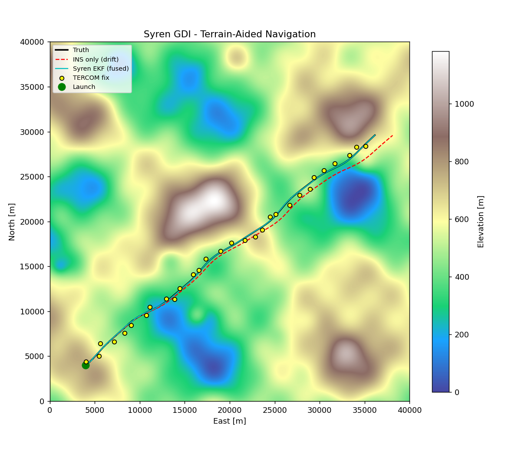
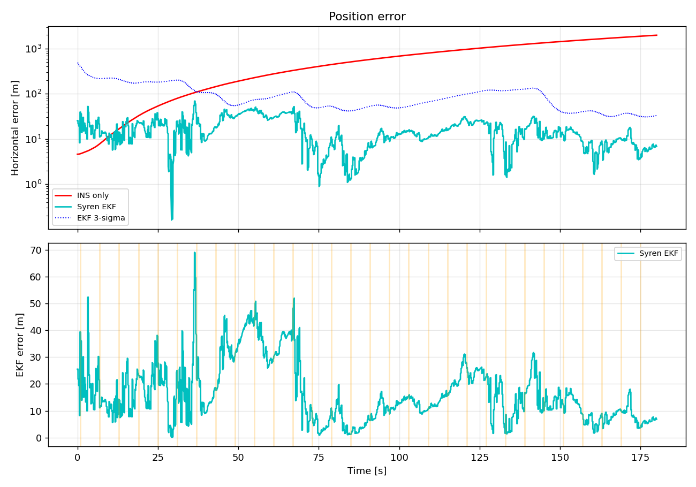

# Syren GDI — GPS-Denied Interceptor

Terrain-aided inertial navigation for a GNSS-denied interceptor. Syren fuses a
strapdown **INS (dead-reckoning)** with **TERCOM** terrain-contour matching and a
recursive **terrain-referenced (TRN)** update inside an **Extended Kalman Filter**,
so the vehicle keeps an accurate fix with no GPS.

## How it works

```
 IMU (accel, gyro) ─► Strapdown INS ─► EKF predict ─┐
                                                     ├─► fused state (pos, vel, bias)
 Radar alt + Baro  ─► ground elevation ─► TERCOM ────┤        │
                                        └► TRN slope ─┘        ▼
   stored DEM ◄──────────── correlate / gradient ──────► position fix
```

- **INS / dead-reckoning** (`ins.py`): integrates specific force; drifts unbounded when unaided — the baseline Syren beats.
- **Terrain / DEM** (`terrain.py`): synthetic fractal elevation map with bilinear query and slope.
- **TERCOM** (`tercom.py`): buffers a strip of measured ground elevations, slides it over the DEM, and picks the horizontal offset with minimum mean-absolute-difference → absolute position fix (sub-cell refined, with covariance from the correlation surface).
- **TRN update** (`ekf.py`): recursive single-point update using measured terrain elevation vs. DEM, Jacobian = local terrain slope.
- **EKF** (`ekf.py`): state `[px, py, vx, vy, bax, bay]`, IMU-driven prediction, Joseph-form covariance, χ² innovation gating.

## Run

```bash
pip install -r requirements.txt
python run_sim.py                 # writes outputs/map.png, outputs/error.png
python run_sim.py --duration 300 --seed 12
pytest -q
```

## Representative result (180 s, 50 Hz)

| metric | INS only | Syren EKF |
|---|---|---|
| RMSE | ~920 m | ~20 m |
| final error | ~1980 m | ~7 m |

~280× drift reduction; EKF error stays inside its 3σ bound.




## Layout

```
syren/
  config.py       tunable parameters
  terrain.py      DEM + interpolation/gradient
  trajectory.py   truth flight path
  imu.py          IMU + altimeter sensor models
  ins.py          strapdown dead-reckoning
  tercom.py       terrain-contour matching
  ekf.py          EKF fusion (TRN + TERCOM)
  navigator.py    full nav loop
  simulation.py   end-to-end harness
run_sim.py        CLI + plots
tests/            pytest suite
```

> Research/simulation only.
