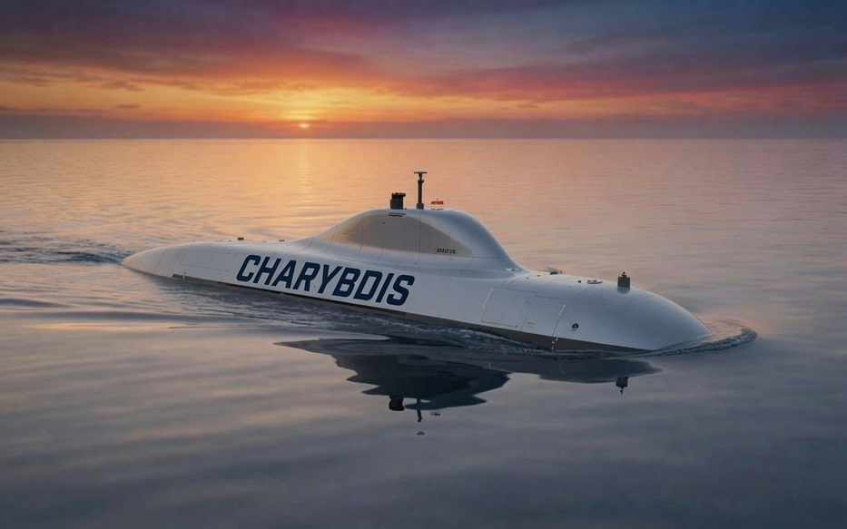

<p align="center">
  
</p>

# Charybdis

Hybrid navigation and terrain-aiding research for surface/submerged UUVs.
Charybdis provides hardware-neutral sensor contracts, conservative state
estimation, bathymetric terrain matching, navigation-health diagnostics, and
waypoint guidance behind a small auditable Python API.

Charybdis is research and simulation software. It is not certified vehicle
software, a safety controller, or evidence of real-world mission validation.

## What Is Finished

The current release baseline has completed the software validation gates below.
See [`docs/VALIDATION.md`](docs/VALIDATION.md) for exact commands and
[`docs/KNOWN_LIMITS.md`](docs/KNOWN_LIMITS.md) for scope.

| Gate | Result |
|------|--------|
| Stable public API | Curated `charybdis` root exports only hybrid navigation primitives |
| CI-quality checks | Lint, format, typing, tests, coverage, and wheel smoke checks |
| Mission engineering matrix | PASS — 6/6 scenarios at 256 runs |
| Harbor release matrix | PASS — 7/7 scenarios at 256 runs |
| Deep-ocean release matrix | PASS — 7/7 scenarios at 256 runs |
| Holdout harbor/deep matrices | PASS — 7/7 scenarios each on disjoint seeds |
| High-resolution bathymetry | PASS — NOAA Monterey P080, 256/256 accepted, CEP95 9.78 m |
| Replay harness | Deterministic packet replay with versioned artifacts |

Verify the retained release artifact pull locally:

```bash
bash scripts/pod/verify_release_cpu.sh
```

Optional remote GPU workflows are documented separately in
[`docs/REMOTE_VALIDATION.md`](docs/REMOTE_VALIDATION.md). They are not required
for the release gates listed above.

## Quick start

Python 3.11+:

```bash
python -m pip install -e ".[dev]"
python -m pytest tests/test_architecture.py
python examples/run_hybrid_patrol.py
python examples/verify_pilot_replay.py
```

## Stable Public API

`import charybdis` exposes the supported hybrid API only:

- `BathymetryMap`, `TerrainProfileMatcher`
- `NavMode`, `SensorPacket`
- `HybridNavState`, `HybridSensorFusion`
- `HybridNavigator`, `HybridStepResult`
- `PatrolExecutor`

```python
from charybdis import (
    HybridNavigator,
    HybridSensorFusion,
    NavMode,
    PatrolExecutor,
    SensorPacket,
)
from charybdis.hybrid import (
    DepthMeasurement,
    GpsMeasurement,
    ImuMeasurement,
    PatrolRoute,
    Waypoint,
)
```

`HybridNavigator.step()` is the primary integration point: it consumes one
coherent `SensorPacket` and returns `HybridStepResult` with navigation state,
diagnostics, and guidance. Contract: [`docs/STABLE_API.md`](docs/STABLE_API.md).

## Architecture Boundary

```text
sensor/log adapters
        |
        v
SensorPacket -> HybridSensorFusion -> HybridNavState
                                          |
                                          v
                                    PatrolExecutor
                                          |
                                          v
                                    PatrolCommand
```

Charybdis returns state and guidance. Integrators remain responsible for sensor
drivers, timing, frame transforms, bathymetry provenance, mission supervision,
collision avoidance, controls, actuators, and independent safety systems.

## Repository Layout

| Path | Purpose |
|------|---------|
| `charybdis/hybrid/` | Stable hybrid navigation and guidance path |
| `charybdis/bathy.py` | Bathymetry map loading and contracts |
| `charybdis/evaluation/` | Confidence bounds, scenario matrices, replay artifacts |
| `examples/` | Deterministic public API examples |
| `scripts/` | Validation, bathymetry preparation, and release tooling |
| `scripts/pod/` | Operational remote validation helpers |
| `docs/` | Architecture, validation, handoff, and operating guidance |

## Documentation

| Document | Purpose |
|----------|---------|
| [`docs/README.md`](docs/README.md) | Documentation index |
| [`docs/GETTING_STARTED.md`](docs/GETTING_STARTED.md) | First integration walkthrough |
| [`docs/VALIDATION.md`](docs/VALIDATION.md) | CI, Phase 2, bathymetry gates |
| [`docs/REMOTE_VALIDATION.md`](docs/REMOTE_VALIDATION.md) | Optional cloud GPU workflows |
| [`docs/INTEGRATION_HANDOFF.md`](docs/INTEGRATION_HANDOFF.md) | Pilot handoff bundle |
| [`docs/KNOWN_LIMITS.md`](docs/KNOWN_LIMITS.md) | What PASS does not mean |
| [`docs/PILOT_EXEC_SUMMARY.md`](docs/PILOT_EXEC_SUMMARY.md) | Executive-ready pilot summary |

## Status Language

Charybdis has completed the declared software validation gates for the current
research baseline. That means the fixed-seed synthetic scenarios and high-res
real-map characterization passed their documented checks. It does **not** mean
field-proven, certified, navigation-grade, or deployment-ready without an
integrator's hardware-in-the-loop and sea-trial evidence.

## License

Proprietary and confidential. See [`LICENSE`](LICENSE).
